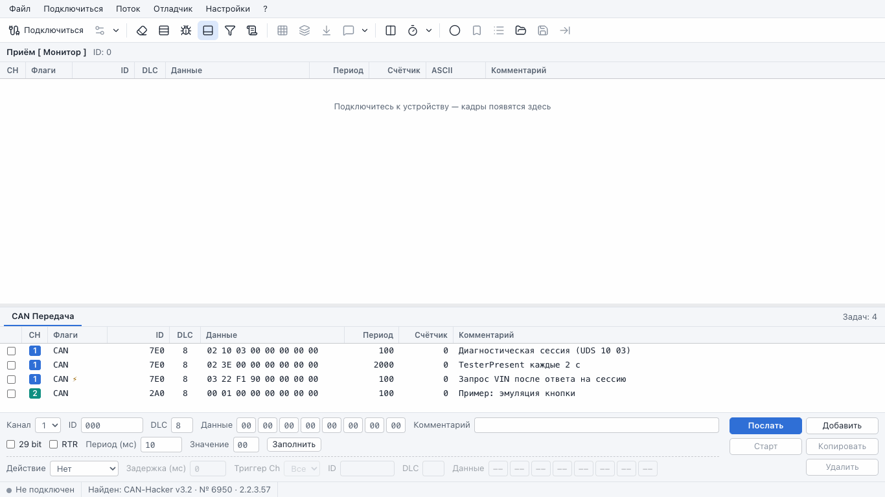
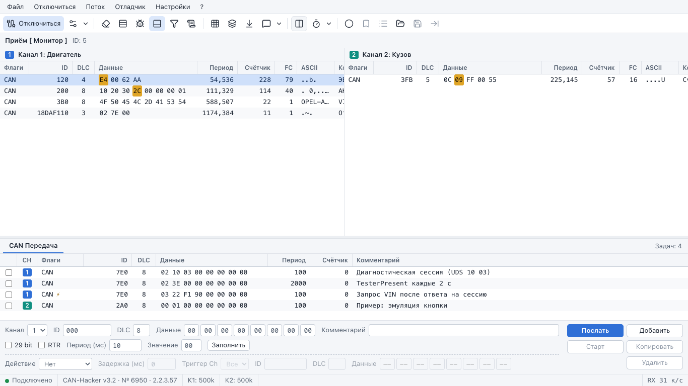
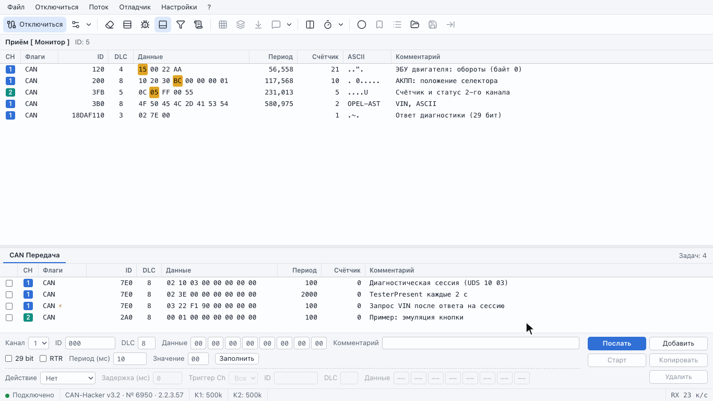
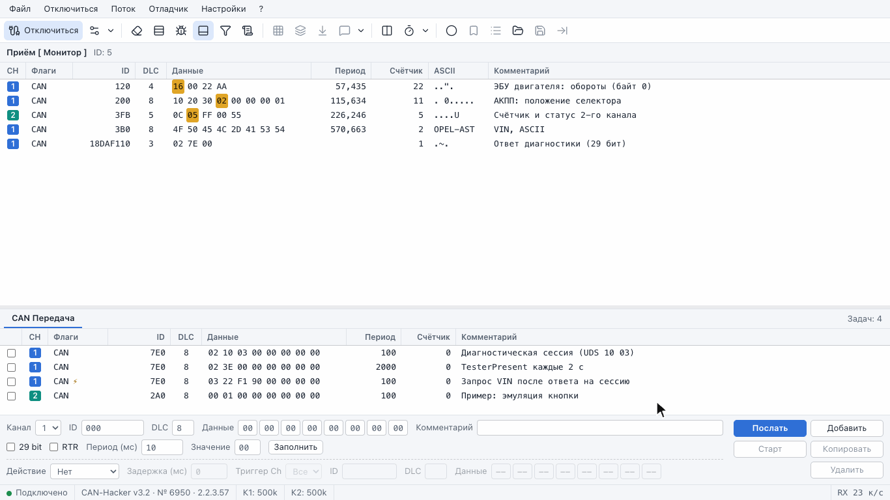
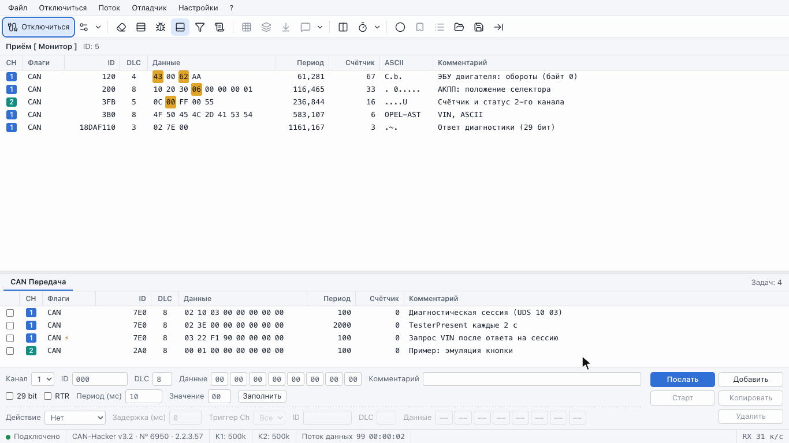
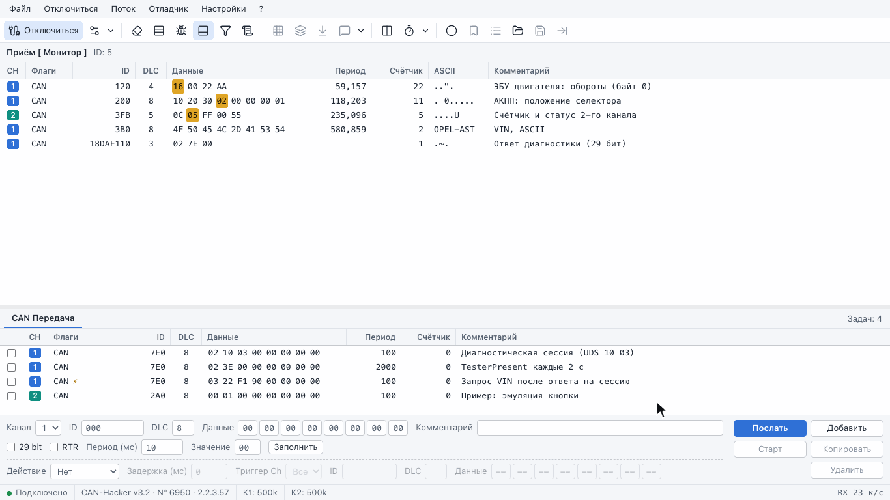

# CarBUS for Mac

Порт десктопной **CarBUS Analyzer** (Windows) для программатора **CAN-Hacker v3.2**
(HW_CH32) на macOS: монитор шины с подсветкой изменений, битовые карты, поток с записью
трейсов, передача с триггерами, фильтры, отладчик трейсов, фоновое логирование.
Бэкенд — Python/FastAPI и [`carbus-lib`](https://pypi.org/project/carbus-lib/) в Docker,
интерфейс — в Chrome. Окна, подписи и хоткеи повторяют русскую версию десктопа (формы
восстановлены из бинарника, см. `docs/reference/carbus-dfm/`).

<p align="center">
  
</p>

**Документация:** [Руководство пользователя](docs/user-guide.md) ·
[Устройство и разработка](docs/architecture.md) ·
[Статус порта по формам десктопа](docs/reference/carbus-dfm/UI_MAP.md)

## Запуск

### Быстрый запуск на Mac

Нужны [Docker Desktop](https://www.docker.com/products/docker-desktop/) (или Colima), Google
Chrome и CAN-Hacker v3.2 по USB.

1. Один раз скачайте проект и поднимите контейнер — из папки проекта:

   ```bash
   git clone https://github.com/Scryptor/CarBusMac.git && cd CarBusMac
   docker compose up -d
   ```

   `docker compose` скачает готовый образ с GitHub (`ghcr.io/scryptor/carbusmac`; он
   собирается на каждую заливку в `main`, для Intel и Apple Silicon) и запустит его. Дальше
   контейнер поднимается сам вместе с Docker, в Docker Desktop его можно останавливать и
   запускать кнопкой.

2. Откройте в **Chrome** <http://localhost:8000> и нажмите **«Подключиться»**. Если прибор не
   виден, окно само скажет, что сделать: обычно — запустить на маке мост. Команда для
   Терминала (уже с папкой проекта) — там же, с кнопкой «Копировать»; окно Терминала с
   мостом не закрывайте, пока работаете. Прибор появится в списке сам — **«Принять»**.

Обновить — `git pull && docker compose pull && docker compose up -d`. Остановить —
`docker compose down`: настройки (`./data`) и трейсы (`./traces`) остаются на маке. Собрать
образ из исходников, а не скачивать, — `docker compose up -d --build`; так же
`docker compose` поступает сам, если готовый образ недоступен.

### Зачем мост

Docker Desktop на macOS запускает контейнеры в Linux-VM и **не пробрасывает в них USB**,
поэтому USB-порт прибора держит небольшой нативный мост на самом маке (`run-bridge.sh`),
а контейнер подключается к нему по TCP через `host.docker.internal`. Мост сам находит
CAN-Hacker среди USB-портов; служебные порты мониторов и других устройств он не трогает.

```bash
./run-bridge.sh          # найдёт CAN-Hacker и отдаст его на 127.0.0.1:7700
```

Подойдёт системный `python3` macOS (3.9+): окружение с pyserial скрипт создаст сам. Прибор
можно подключить к USB и после запуска моста — мост и интерфейс увидят его сами. Порт моста —
**7700**: macOS его не занимает (а 7000 — порт штатного моста carbus-lib — на macOS 12+
держит «Приёмник AirPlay»); другой порт — первым аргументом `run-bridge.sh` и тот же в
«Настройках устройства» → «Дополнительно».

На **Linux** мост не нужен: прибор пробрасывается прямо в контейнер —
`docker compose -f docker-compose.yml -f docker-compose.usb.yml up -d` (узел порта —
`CARBUS_USB`, по умолчанию `/dev/ttyACM0`).

Интерфейс рассчитан на экран от **1366×768**. Без прибора всё можно посмотреть на
демо-источнике кадров — см. [Разработка](#разработка).

## Возможности

### Подключение и каналы



**«Подключиться»** открывает «Настройки устройства»: найденный прибор — список CAN-Hacker
на USB обновляется сам (вставили прибор — он появился, несколько — выбираете нужный; чужие
USB-порты видны, но не выбираются; если прибора нет, под списком написано почему и что
сделать: запустить мост — с готовой командой для Терминала и кнопкой «Копировать» — или
вставить прибор в USB) — и для каждого канала —
название, номинальная скорость (стандартные прибора или свои из «Управления скоростями»:
подбор Делителя/Seg1/Seg2/SJW по скорости и точке выборки, фактическая скорость и
точность), «Только слушать», терминатор 120 Ом, «Автоматическое открытие».
«Принять» подключает; при открытом соединении — переподключает (закрыть отдельный канал
протокол прибора не умеет, скорость меняется только так). В статусбаре — прибор,
прошивка, серийный номер и состояние каналов, а пока соединения нет — найден ли прибор
на USB; «Информация об устройстве» — в меню «?»
и в меню опций каналов, там же терминатор включается на лету.

### Монитор, битовая карта, данные сообщения

Монитор (гифка в начале) показывает по строке на сообщение: CH, Флаги, ID, DLC, Данные,
Период, Счётчик, FC, ASCII, Комментарий. Изменившиеся байты горят «послесвечением» на
время «Сбросить после»; режим редких данных подсвечивает только то, что до этого долго не
менялось. **F3** — битовая карта сообщения (x80…x01, десятичное значение байта,
подсветка переключившихся бит, комментарий), окон может быть несколько. **Ctrl+F3** —
«Данные сообщения»: все различные payload одного ID со счётчиком и периодом (нужен
агрегатор уникальных данных, он же добавляет колонку FC). **F4** — комментарий к ID,
комментарии совместимы с десктопными `.cmt`. Контекстное меню: сохранить RX-List,
копировать в TX-List (Ctrl+↓), добавить ID в фильтр, ID в HEX, сортировка, группировка
по каналам. «Раздельный приём» — по таблице на канал:



### Поток, запись, метки и трейсы



**F2** переключает приём в режим потока: хронология Rx и Tx с временем от первого кадра.
**F5** включает запись (она идёт и в режиме монитора — видно в статусбаре), **F8** ставит
метку с подписью и комментарием, **F9** — автоматическую, список меток умеет перейти к
метке. Поток сохраняется в `.trc` (как у десктопа) или `.jsonl` (наш формат, хранит
Rx/Tx), загружается обратно и открывается в отладчике (**Ctrl+F12**). Буфер — до
5 000 000 кадров на бэкенде, таблица подгружает только видимое.

### Передача и триггеры


Док «CAN Передача»: список задач с флажком цикла, редактор задачи (канал, ID, DLC, байты,
29 bit, RTR, период, комментарий, «Заполнить»), кнопки Послать (Enter) · Добавить ·
Старт/Пауза · Копировать · Удалить. У каждой задачи свой **триггер**: по приёму кадра с
заданными каналом, ID, DLC и данными (пустая ячейка — любое значение) через задержку
выполняется Одиночный / Старт / Стоп — так на гифке запрос VIN уходит сам после
положительного ответа на сессию. Списки задач — `.tsk` десктопа или `.json`; при запуске
список восстанавливается.

### Фильтры



**Ctrl+F** — панель фильтров. «Фильтр ID/Маска» — аппаратные слоты прибора (их число
сообщает сам прибор): включённые пропускают только совпавшие ID, все выключенные —
принимается всё. «Фильтр Диапазон» — программные диапазоны по каналам с исключениями
(ID/Маска); они отсеивают кадры до монитора, потока и записи. «Простой режим» прячет маску.
Наборы фильтров сохраняются в файл и восстанавливаются при запуске.

### Отладчик



**F12** — отладчик трейсов: таблица строк с временем, паузами и комментариями, справа —
таблица используемых ID (неотмеченные скрываются и не воспроизводятся). Воспроизведение
(**F9**) в канал 1, канал 2 или в окно Приём, пауза по меткам времени или фиксированная,
цикл, только выделенные строки, шаг (**F8**), точки останова (**F5**), «Остановить при
получении данных», начало и конец. Строки добавляются, вставляются, редактируются,
запрещаются и копируются в TSV; трейс сохраняется в `.trc`/`.jsonl`.

### Настройки и фоновое логирование



«Настройки приложения»: стиль (светлый / тёмный / как в ОС), шрифт и размер таблиц,
подсветка изменённых байтов (цвет, «Сбросить после»), агрегатор, восстановление списков,
формат копирования строк, фильтры. **Фоновое логирование**: пока прибор подключён, кадры
пишутся в `.trc` в папку трейсов по маске имени (`%Y-%m-%d_%H-%M-%S`) с метаинформацией
(тип транспорта, марка, модель, кузов, год).

## Где лежат данные

| Папка на маке | Что внутри |
|---|---|
| `./traces` | трейсы: «Сохранить поток», файлы фоновой записи; отсюда их открывают «Загрузить поток» и отладчик. Форматы: `.trc` (как у десктопа, v3) и `.jsonl` (наш, сохраняет Rx/Tx) |
| `./data` | настройки, подключение, свои скорости, список передачи, фильтры, комментарии; `data/lists/` — файлы списков: комментарии `.cmt`, задачи передачи `.tsk` (форматы десктопа) и наш `.json` |

В диалогах файлов есть «Загрузить с компьютера…» и «Скачать». Состояние живёт на
сервере: перезагрузка страницы не рвёт подключение, запись и передачу.

## Хоткеи

| Окно приёма | | Отладчик | |
|---|---|---|---|
| F2 | Монитор / Поток | F9 | Запуск / пауза |
| F3 / Ctrl+F3 | Битовая карта / Данные сообщения | F8 | Шаг |
| F4 | Комментарий к сообщению | F5 / Ctrl+F5 / Shift+F5 | Точка останова / список / удалить все |
| F5 | Запись потока | Ctrl+F3 | Таблица используемых ID |
| F8 / F9 | Метка / автоматическая метка | F4 | Комментарий |
| Ctrl+N | Сбросить полученные данные | Ctrl+N / Ctrl+O | Новый / открыть трейс |
| Ctrl+F | Панель фильтров | Ctrl+S / Ctrl+Shift+S | Сохранить / сохранить как |
| Ctrl+↓ | Копировать в TX-List | Ins / Ctrl+Ins | Добавить / вставить строку |
| Ctrl+F12 | Открыть поток в отладчике | Ctrl+Enter / Ctrl+Del | Редактировать / удалить строку |
| F12 | Отладчик | Ctrl+C | Копировать выделенные строки |

Сочетания с **Ctrl**, как в десктопе: Cmd-сочетания остаются браузеру. На клавиатуре
мака нет Insert, а Del — это fn+Delete; все действия с этими клавишами есть в
контекстном меню таблицы трейса. Полный список — в
[руководстве](docs/user-guide.md#хоткеи).

## Чего нет на этапе 1

DBC (менеджер, сигналы, графики), LIN, CAN-FD, CAN/LIN Bomber, шлюз CAN1⇔CAN2,
загрузка устройства (статистика), ALS, автоопределение скорости, JS-консоль, импорт
форматов 7GIS / CAN Spy / Vega, языки кроме русского. «Отдельные окна» десктопа стали
панелями и видами внутри одной страницы. В «Настройках фонового логирования» одна
конфигурация (без списка пресетов десктопа). Что сделано, а что нет — по каждой форме в
`docs/reference/carbus-dfm/UI_MAP.md`, раздел «Статус порта».

## Безопасность

- Интерфейс и WebSocket слушают только `127.0.0.1` мака; запросы с чужим `Host` или
  `Origin` отклоняются — открытая в том же браузере посторонняя страница не может ни слать
  кадры в шину, ни писать файлы.
- Мост открывает только порты, распознанные как CAN-Hacker (или заданные явно через
  `CARBUS_SERIAL`); список портов строится без их открытия.
- Мост по умолчанию тоже слушает только `127.0.0.1` (порт 7700): Docker Desktop достаёт
  сервисы хоста на loopback через `host.docker.internal`, в локальную сеть мост не
  публикуется. Если ваш рантайм не дотягивается до loopback — запустите
  `CARBUS_BRIDGE_HOST=0.0.0.0 ./run-bridge.sh` и держите firewall включённым.
- Публичный relay из `carbus-lib` **не используется** — трафик шины наружу не уходит.

## Разработка

```bash
# бэкенд
cd backend && python3.12 -m venv .venv            # бэкенду нужен Python 3.10+ (мосту хватает системного 3.9)
.venv/bin/pip install -c constraints.txt -e ".[dev]"
.venv/bin/pytest -q
.venv/bin/python -m app.demo --port 8765    # демо без прибора: http://127.0.0.1:8765
.venv/bin/python -m uvicorn app.server:app --port 8000   # без Docker: прибор по USB виден напрямую, мост не нужен
# на реальном железе: запустить мост, затем
CARBUS_BRIDGE=127.0.0.1:7700 .venv/bin/pytest -q tests/test_carbus_session_smoke.py

# фронт
cd frontend && npm install
npx vitest run && npx tsc --noEmit -p .
npm run build       # статика для бэкенда (frontend/dist)
npm run dev         # vite dev-сервер (WS и REST проксируются на демо :8765)

# гифки и скриншоты для README и руководства (нужен установленный Google Chrome)
npm run demos                       # все сценарии → docs/screenshots/
npm run demos -- --only monitor     # один сценарий

# образ из своих исходников (готовый на GitHub собирает .github/workflows/docker.yml)
docker compose up -d --build
```

Как всё устроено внутри (мост → бэкенд → браузер, протокол WebSocket, модули, скрипт
записи гифок) — в [docs/architecture.md](docs/architecture.md). Ручная проверка на
реальной шине — в [руководстве](docs/user-guide.md#проверка-на-реальной-шине).
