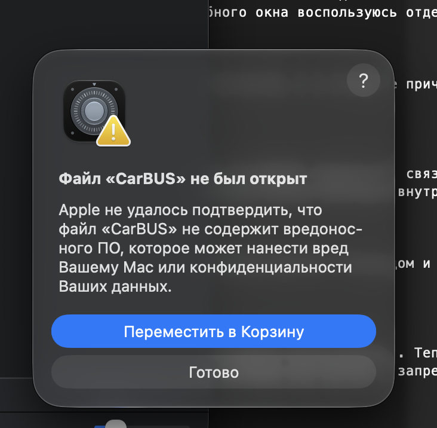
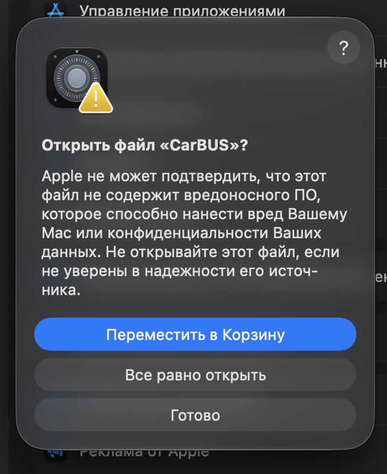
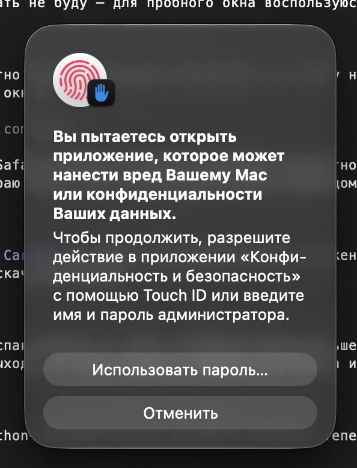
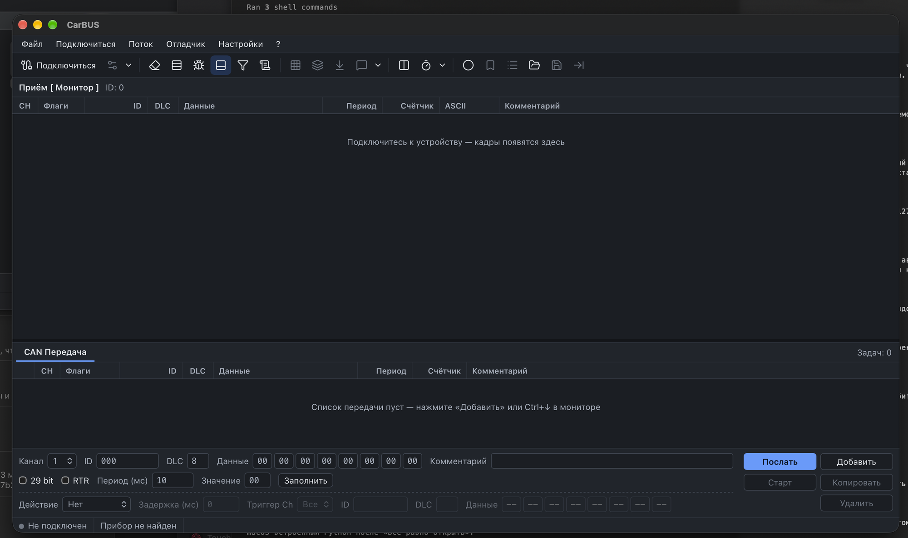
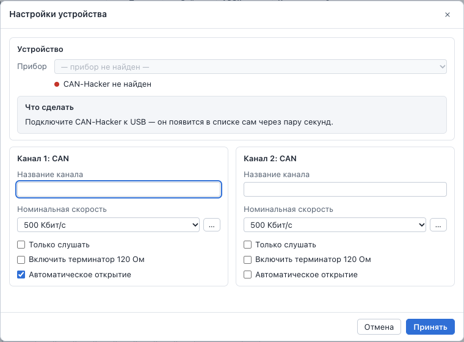

# CarBUS для Mac — как установить

CarBUS — программа для работы с программатором CAN-Hacker v3.2 на маке. Всё нужное уже
внутри неё: ничего дополнительно ставить не надо — ни Docker, ни Python, ни Терминал. Один и
тот же файл подходит для любых маков (Apple Silicon и Intel) с macOS 12 и новее.

## 1. Скачайте

Откройте страницу загрузки **[CarBUS — последняя версия](https://github.com/Scryptor/CarBusMac/releases/latest)**
и в разделе «Assets» нажмите на файл `CarBUS-….dmg`. Он скачается в папку «Загрузки».

## 2. Установите

Дважды щёлкните скачанный `CarBUS-….dmg`. В открывшемся окне перетащите значок **CarBUS**
на папку **«Программы»**. После этого окно можно закрыть, а диск «CarBUS» на рабочем столе —
извлечь.

## 3. Первый запуск — один раз

CarBUS не из App Store и не подписан в Apple, поэтому в первый раз macOS попросит подтвердить,
что вы доверяете программе. Это делается один раз — и ещё раз после каждой новой версии.

1. Откройте «Программы» и дважды щёлкните **CarBUS**. macOS скажет, что файл не был открыт.
   Нажмите **«Готово»** (не «Переместить в Корзину»).

   

2. Откройте меню  → **«Системные настройки»** → **«Конфиденциальность и безопасность»** и
   прокрутите вниз, до раздела «Безопасность». Напротив строки «Файл «CarBUS» заблокирован для
   защиты Вашего Mac» нажмите **«Все равно открыть»**.

   

3. macOS переспросит — нажмите **«Все равно открыть»**.

   

4. Подтвердите отпечатком пальца (Touch ID) или паролем от мака.

   

5. Откроется окно CarBUS.

   

Дальше CarBUS открывается как любая программа: из «Программ», Launchpad или Dock (чтобы значок
остался в Dock: правый щелчок по нему → «Параметры» → «Оставить в Dock»).

## 4. Подключите прибор

1. Подключите CAN-Hacker к маку USB-кабелем — лучше напрямую, без хабов и переходников.
2. В CarBUS нажмите **«Подключиться»**. В окне «Настройки устройства» прибор уже выбран:
   «CAN-Hacker v3.2 · № … — USB».
3. Выберите скорость шины (у большинства машин — 500 Кбит/с) и нажмите **«Принять»**.

**На машине** включите у каналов **«Только слушать»** — тогда прибор только читает шину и
ничего в неё не отправляет. Переключатели терминаторов на плате прибора — в положение **OFF**:
шина машины уже нагружена своими.

Если прибор не найден, окно так и скажет:

Проверьте кабель (бывают кабели только для зарядки) и попробуйте другой USB-порт — прибор
появится в списке сам.

## Новая версия

Скачайте свежий `.dmg` по той же ссылке и перетащите CarBUS в «Программы» с заменой. Первый
запуск новой версии снова потребует шага 3.

## Где мои файлы

Трейсы и настройки CarBUS хранит в своей папке. Открыть папку с трейсами — меню **CarBUS →
«Показать трейсы в Finder»**. Сохранить трейс в другое место — «Файл → Сохранить поток», затем
в окне файлов выбрать его и нажать «Скачать».

## Удалить

Перетащите CarBUS из «Программ» в Корзину. Чтобы удалить и трейсы с настройками, удалите папку
`~/Library/Application Support/CarBUS` (в Finder: «Переход» → «Переход к папке…», вставьте путь).

## Если что-то не так

| Что видно | Что сделать |
|---|---|
| В настройках нет кнопки «Все равно открыть» | Она появляется только после попытки открыть CarBUS и видна недолго (около часа). Снова дважды щёлкните CarBUS (шаг 3.1) и сразу откройте настройки. |
| Прибор не найден | Проверьте кабель и подключите прибор к маку напрямую. Прибор перестал отвечать — выньте USB-кабель на пару секунд и вставьте снова. |
| «CarBUS не ответил за 30 секунд» или «CarBUS неожиданно остановился» | Нажмите «Запустить снова». Не помогло — закройте программу (⌘Q) и откройте снова. Для разработчика пригодится журнал `~/Library/Logs/CarBUS/backend.log`. |
| Окно программы пустое или «зависло» | Меню «Окно» → «Обновить страницу» (⌘R). |
