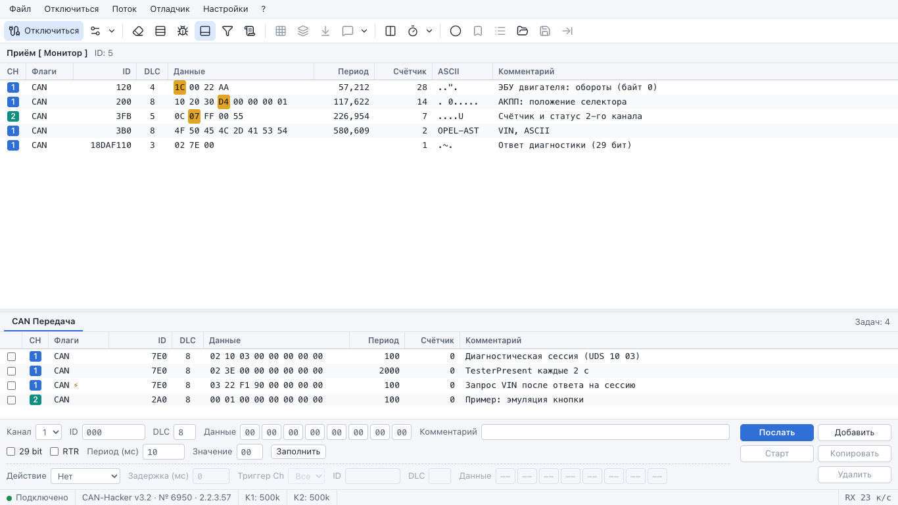
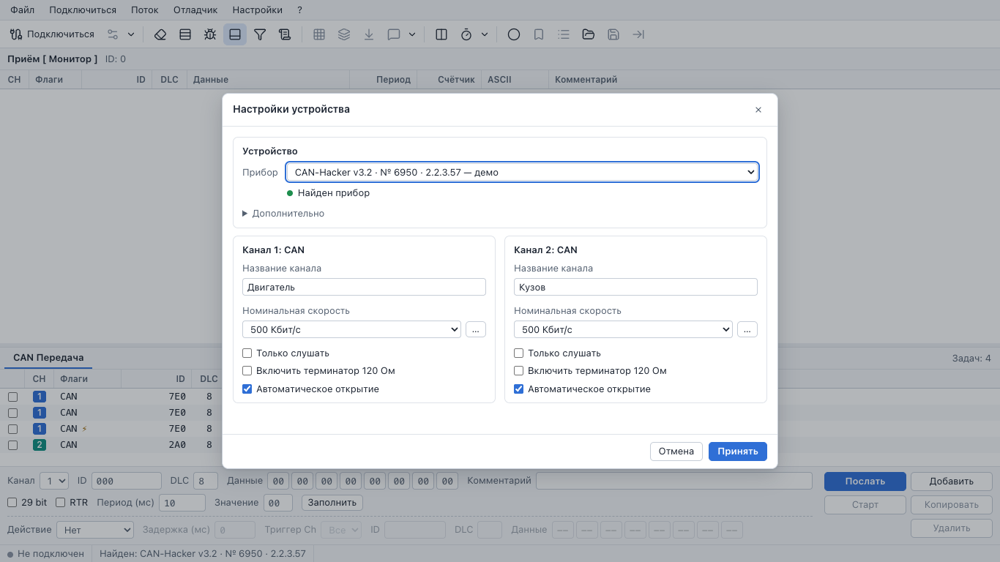
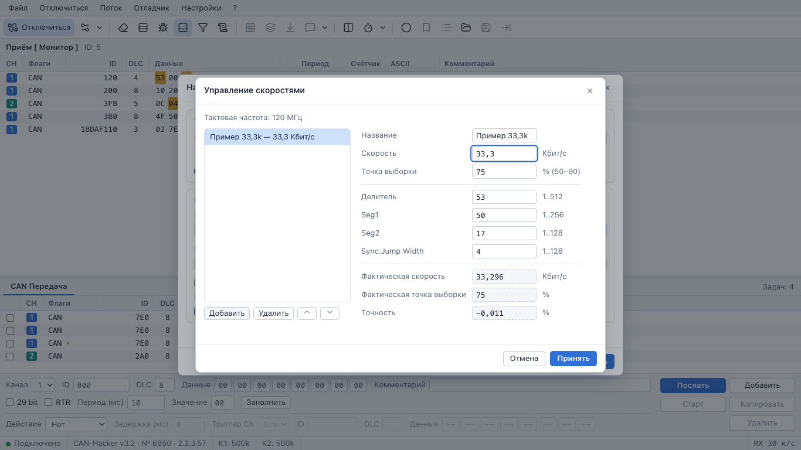
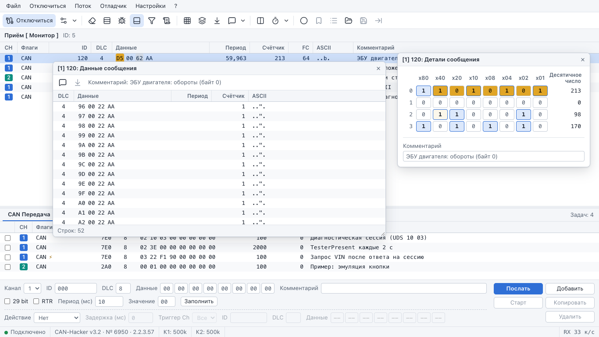
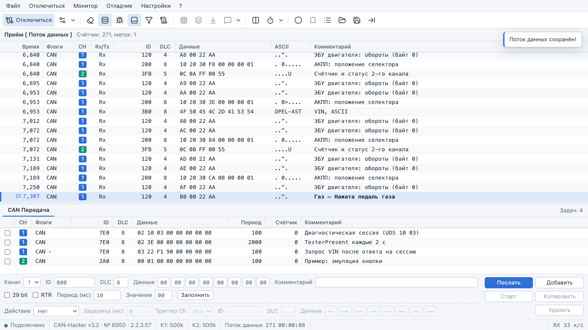
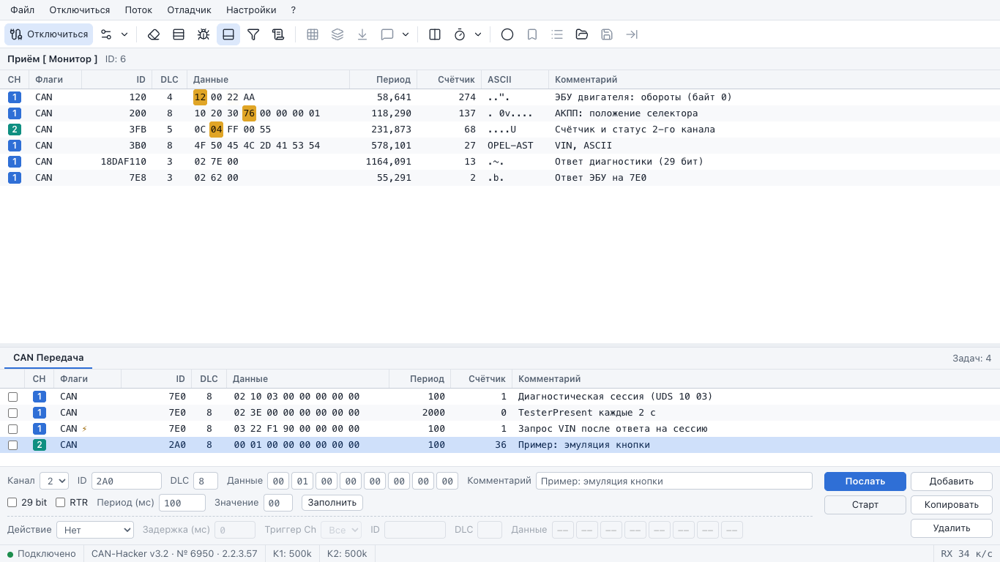
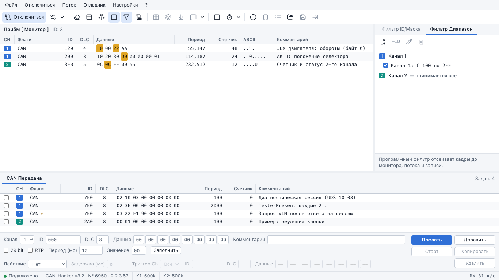
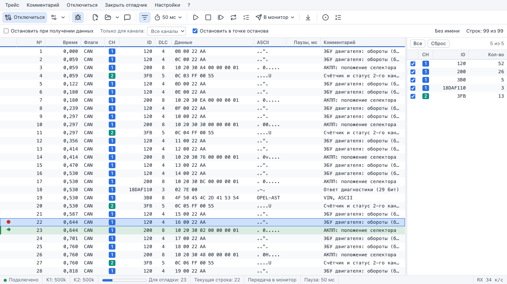
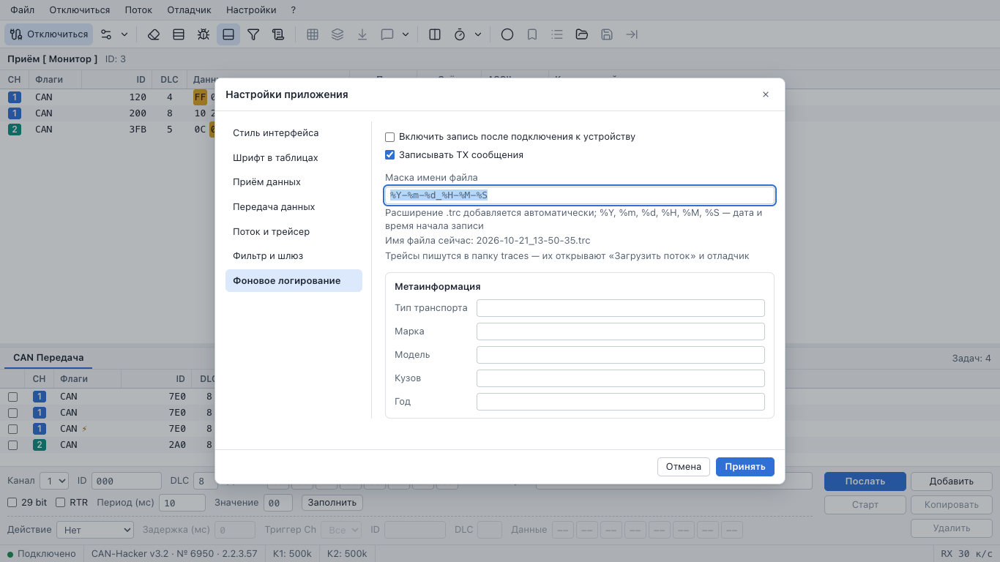

# CarBUS for Mac — руководство пользователя

Что умеет каждое окно, поле и кнопка. Гифки с основными сценариями — в [README](../README.md),
устройство программы — в [architecture.md](architecture.md).

Содержание: [Запуск](#запуск) · [Главное окно](#главное-окно) · [Подключение](#подключение-к-прибору) ·
[Монитор](#монитор) · [Поток](#поток) · [Передача](#передача) · [Фильтры](#фильтры) ·
[Отладчик](#отладчик) · [Настройки](#настройки-приложения) · [Фоновое логирование](#фоновое-логирование) ·
[Файлы и папки](#файлы-и-папки) · [Хоткеи](#хоткеи) · [Проверка на реальной шине](#проверка-на-реальной-шине) ·
[Если что-то не так](#если-что-то-не-так)

## Запуск

**Программа для Mac (CarBUS.app)** — обычный способ: скачать `.dmg`, перетащить в «Программы»,
первый раз открыть через «Все равно открыть» — по шагам и с картинками в
[install-mac.md](install-mac.md). Ни Docker, ни мост, ни Терминал ей не нужны: бэкенд встроен,
прибор она находит по USB сама. Данные — в `~/Library/Application Support/CarBUS` (`data`,
`traces`; меню CarBUS → «Показать трейсы в Finder»), журналы — `~/Library/Logs/CarBUS`. Интерфейс
тот же, что ниже, только в «Настройках устройства» нет «Дополнительно» с адресом моста.

Дальше — запуск из исходников через Docker (разработка, Linux). Нужны: Mac, Docker Desktop (или
Colima), Google Chrome и программатор CAN-Hacker v3.2 (в приборе — `HW_CH32`, два канала
классического CAN и LIN; LIN в порте не поддерживается).

1. `docker compose up -d` — из папки проекта: контейнер с бэкендом, интерфейс на
   <http://localhost:8000>. Готовый образ (`ghcr.io/scryptor/carbusmac`, Intel и Apple Silicon)
   скачивается с GitHub; `docker compose up -d --build` собирает его из исходников (так же
   compose поступает сам, если готовый образ недоступен). Папки `./traces` и `./data`
   монтируются в контейнер, файлы остаются на маке. Дальше контейнер поднимается сам вместе с
   Docker — в Docker Desktop его можно останавливать и запускать кнопкой. Папку, из которой
   его подняли, docker-compose передаёт бэкенду: по ней «Настройки устройства» покажут
   точную команду запуска моста.
2. `./run-bridge.sh` — нативный мост на маке: Docker Desktop на macOS не пробрасывает USB в
   контейнер, поэтому порт прибора держит этот процесс. Заранее его можно не запускать: если
   моста нет, «Настройки устройства» скажут об этом и дадут команду для Терминала с кнопкой
   «Копировать». Скрипт сам создаёт окружение с pyserial в `$TMPDIR/carbus-bridge-venv`
   (подойдёт системный `python3` macOS 3.9 или любой новее; другой —
   `CARBUS_PYTHON=/путь/к/python3`) и слушает `127.0.0.1:7700` — этот порт на маке свободен
   (7000, порт штатного моста carbus-lib, на macOS 12+ держит «Приёмник AirPlay»). CAN-Hacker
   он находит сам по USB-описателям и пишет, что нашёл:

   ```
   12:00:01  Найден CAN-Hacker v3.2 № 6950 (/dev/cu.usbmodem00000000001A1), прошивка 2.2.3.57
   12:00:01  Пропущен (не CAN-Hacker): LG Monitor Controls (/dev/cu.usbmodem506NTBKGE1012)
   12:00:01  Мост слушает 127.0.0.1:7700 (бэкенд в Docker ходит через host.docker.internal:7700). Остановить — Ctrl+C.
   ```

   Служебные USB-порты других устройств (мониторов, плат, телефонов) мост не открывает.
   Прибор можно вставить и после запуска — мост подхватит его без перезапуска («Подключён по
   USB: …»). Прибор с нестандартными USB-строками задаётся явно:
   `CARBUS_SERIAL=/dev/cu.usbmodemXXX ./run-bridge.sh`. Номер TCP-порта — первым аргументом.
3. В Chrome: «Подключиться» → в «Настройках устройства» уже выбран найденный прибор → «Принять».

**Linux.** Там USB пробрасывается прямо в контейнер, мост не нужен:
`docker compose -f docker-compose.yml -f docker-compose.usb.yml up --build`. Узел порта —
`CARBUS_USB` (по умолчанию `/dev/ttyACM0`; какой у прибора — `ls -l /dev/serial/by-id/`).
Порт пробрасывается при старте контейнера: если прибор переподключили и он получил другой
номер, перезапустите контейнер. В «Настройках устройства» такой прибор помечен «USB в
контейнере».

**Без Docker** бэкенд видит USB сам (`backend/.venv/bin/python -m uvicorn app.server:app
--port 8000`), мост ему не нужен.

Остановить — `Ctrl+C` в окне моста и `docker compose down`. Обновить —
`git pull && docker compose pull && docker compose up -d` (свой образ из исходников —
`docker compose up -d --build`).

Состояние (подключение, запись, передача, отладчик) живёт в бэкенде, а не во вкладке:
перезагрузка страницы и даже вторая вкладка получают тот же снимок состояния.

## Главное окно



**Строка меню** — как в десктопе: Файл (сохранить RX-List; загрузить/сохранить данные для
передачи; загрузить/сохранить комментарии; загрузить/сохранить поток) · Подключиться /
Отключиться · Поток / Монитор · Отладчик · Настройки (приложения, фонового логирования,
устройства) · ? (информация об устройстве, о программе). В виде отладчика вместо «Файл» и
«Поток» — меню «Трейс» и «Комментарий».

**Тулбар.** Общая часть: Подключиться/Отключиться · опции каналов (меню: информация об
устройстве, терминатор по каналам, настройки устройства) · Сбросить полученные данные
(Ctrl+N) · Монитор/Поток (F2) · Отладчик (F12) · док «CAN Передача» · панель фильтров
(Ctrl+F) · настройки фонового логирования. Кнопки вида приёма: битовая карта (F3) ·
данные сообщения (Ctrl+F3) · копировать в TX-List (Ctrl+↓) · комментарий (F4, с меню
файлов комментариев) · раздельный приём · подсветка редких данных (с меню периода) ·
запись (F5) · метка (F8) и список меток · загрузить поток · сохранить поток · открыть в
отладчике (Ctrl+F12). У каждой кнопки подсказка с хоткеем.

**Рабочая область**: приём (монитор или поток) слева сверху, панель фильтров справа
(скрывается), док передачи снизу (скрывается). Разделители тянутся мышью, размеры и
видимость панелей запоминаются в браузере.

**Статусбар**: состояние связи с прибором (Не подключен · Соединение… · Подключено ·
Ошибка с текстом) · пока соединения нет — найден ли прибор на USB («Найден: CAN-Hacker
v3.2 · № 6950 · 2.2.3.57» — щелчок открывает «Настройки устройства»; «Прибор не найден» —
причина во всплывающей подсказке) · при подключении — прибор (модель, серийный номер,
прошивка; в подсказке — что сообщил сам прибор и путь к нему) · по ячейке на канал («К1: 500k,
только прослушивание, 120 Ом», «К2: закрыт», «К1: отказ») · запись/поток (число кадров и
длительность) · фоновая запись (имя файла) · скорость приёма «RX N к/с». Если пропала связь
браузера с сервером (контейнер остановлен), в статусбаре только «Нет связи с сервером» —
состояние прибора в это время неизвестно; вкладка переподключается сама.

Уведомления («Поток данных сохранён!», ошибки) появляются в правом верхнем углу и гаснут
сами. Пока открыт модальный диалог, хоткеи главного окна не работают; в полях ввода
срабатывают только F-клавиши.

## Подключение к прибору



«Подключиться» (тулбар или меню) открывает **«Настройки устройства»** (они же в меню
Настройки → Настройки устройства). Сверху — **прибор**: программа сама ищет CAN-Hacker на
USB, пока окно открыто (раз в 2 секунды, как список источников в десктопе), так что
вставленный прибор появляется в списке без перезапуска, а выдернутый — пропадает.

| Поле | Что значит |
|---|---|
| Прибор | найденные CAN-Hacker: модель, серийный номер, прошивка и путь — «через мост» (бэкенд в Docker на маке), «USB в контейнере» (Docker на Linux с пробросом USB), «USB» (бэкенд без Docker). Один найденный выбран сам; если их несколько — выберите нужный. «(возможно, CAN-Hacker)» — порт с VID:PID прибора, но без его имени; «— занят» — к прибору уже подключена другая программа. В группе «Другие USB-порты — не CAN-Hacker» видны порты мониторов, плат и т. п.: выбрать их нельзя, мост их не открывает |
| строка под списком | «Найден прибор» · «Подключён» · «Найдено 2 прибора — выберите нужный» · «Выбранный прибор отключён» · или почему прибора нет: «Мост не запущен», «Мост не отвечает: на его порту другая программа», «Мост работает, но CAN-Hacker не подключён по USB»; в программе для Mac — «CAN-Hacker не найден» |
| Что сделать | появляется, когда прибора нет. В Docker без моста — три шага для Терминала и команда запуска моста с кнопкой «Копировать»: `cd <папка проекта> && ./run-bridge.sh` (папку подставляет docker-compose; если контейнер поднят из образа без папки проекта, команда один раз скачает проект с GitHub в `~/CarBusMac`). Мост работает (или моста нет вовсе — программа для Mac), а прибора нет — «Подключите CAN-Hacker к USB». Пропадает сам, как только прибор появился в списке |
| Дополнительно → Мост (хост:порт) | в программе для Mac раздела нет — мост ей не нужен. Адрес нативного моста на маке. В Docker — `host.docker.internal:7700`; адрес на `:7000`, сохранённый прежней версией (тогда мост слушал 7000), программа сама переносит на 7700. Раскрывается само, если мост не отвечает, прибора нет и нет подсказки с командой (бэкенд без Docker); список пересчитывается по введённому адресу сразу, команда в «Что сделать» — тоже (с портом, если он не 7700) |
| Название канала | подпись канала (до 16 символов) в раздельном приёме и меню опций каналов |
| Номинальная скорость | стандартные скорости прибора: 10, 20, 33,3, 50, 62,5, 83,3, 95,2, 100, 125, 250, 400, 500, 800, 1000 Кбит/с — и свои из «Управления скоростями» (кнопка «…») |
| Только слушать | канал открывается в режиме прослушивания: прибор не подтверждает кадры и ничего не шлёт в шину — безопасно для машины |
| Включить терминатор 120 Ом | только если прибор сообщил, что канал это умеет; иначе флажок заблокирован (по руководству у CH32 программного терминатора нет) |
| Автоматическое открытие | открывать ли канал сразу после подключения к прибору; по умолчанию открыт канал 1 |

«Принять» сохраняет настройки и подключается к выбранному прибору (если найдено несколько, а
прибор не выбран, окно попросит выбрать). Единственный найденный прибор запоминается как
«автоматически», поэтому настройки переживают смену USB-порта. Если соединение уже открыто — переподключает
с новыми настройками: протокол прибора не умеет закрывать отдельный канал, поэтому скорость
или режим канала меняются только так. «Отмена» ничего не меняет.

**«Управление скоростями»** (кнопка «…» рядом со скоростью):



Список своих скоростей слева (Добавить · Удалить · выше · ниже), справа — название,
скорость в Кбит/с и точка выборки 50–90 % (по умолчанию 75). По ним подбираются Делитель
(1..512), Seg1 (1..256), Seg2 (1..128) и Sync.Jump Width (1..128): сначала минимальная
ошибка скорости, затем ближайшая точка выборки, затем 8–25 квантов на бит; SJW = min(Seg2, 4).
Тайминг можно править руками — ниже пересчитываются фактическая скорость, фактическая
точка выборки и точность в процентах. Тактовая частота берётся из прибора (120 МГц у
CH32), без прибора — по умолчанию. «Принять» сохраняет список и подставляет добавленную
скорость в канал.

**«Информация об устройстве»** (меню «?» или опции каналов): прибор, серийный номер,
прошивка, возможности (шлюз, ISO-TP, буфер передачи, задачи передачи в приборе), каналы —
тип, частота, число аппаратных фильтров, текущее состояние и особенности канала. Текст
копируется кнопкой.

**Меню опций каналов** (стрелка рядом с кнопкой подключения): терминатор 120 Ом включается
и выключается на лету для открытого канала, если прибор его поддерживает.

Если прибор выдернули из USB или остановили мост посреди работы, в статусбаре появится
«Ошибка: Приём остановлен: связь с прибором потеряна…», запись и передача остановятся;
вставьте прибор — он снова появится в списке — и «Подключиться» → «Принять». Если мост или
прибор не отвечают, подключение прекращается через 5 секунд с объяснением, а не висит;
пока оно идёт, «Отключиться» его отменяет.

Передать кадр можно только в открытый канал без «Только слушать»: иначе задача, отладчик и
«Послать» сообщат «Канал N не открыт» или «…в режиме «Только слушать» — передача
невозможна», а в поток такой кадр не попадёт.

## Монитор



Одна строка на сообщение — ключ «канал + ID + 11/29 бит», значения обновляются на месте
25 раз в секунду (бэкенд копит последнее значение по ID и шлёт только изменившееся, поэтому
загруженная шина монитор не затапливает).

| Колонка | Что в ней |
|---|---|
| CH | канал (1 — синий, 2 — зелёный) |
| Флаги | `CAN`, `CAN RTR` (FD-кадры порт не принимает) |
| ID | в HEX (3 знака для 11 бит, 8 — для 29) или в DEC, см. контекстное меню |
| DLC, Данные | длина и байты; изменившийся байт подсвечивается |
| Период | мс между двумя последними кадрами этого ID, с запятой и тремя знаками |
| Счётчик | сколько кадров этого ID принято |
| FC | число различных payload (только с включённым агрегатором) |
| ASCII | байты как печатные символы, непечатные — точка |
| Комментарий | комментарий к ID |

Порядок строк — по первому появлению, как в десктопе; «Сортировать принятые сообщения»
и «Группировать по каналам» — в контекстном меню. Ctrl+N очищает таблицу.

**Подсветка изменений.** Байт горит цветом подсветки «Сбросить после» (500–10 000 мс, по
умолчанию 2000) с момента изменения. Только что появившееся сообщение (и все строки после
Ctrl+N) целиком не загорается: сравнивать ещё не с чем, подсвечивается то, что изменилось
после появления. **Редкие данные** (кнопка с таймером): подсвечиваются
только изменения байтов, которые до этого стояли неизменными не меньше «периода редких
данных» (100–10 000 мс, по умолчанию 10 000) — частые счётчики не мешают увидеть редкое
событие, например нажатую кнопку. Период задаётся в меню кнопки.

**Битовая карта (F3, двойной щелчок по строке).** Плавающее окно «[CH] ID: Детали
сообщения»: каждый байт — строка из 8 бит x80…x01 и столбец «Десятичное число»;
переключившиеся биты горят тем же «послесвечением». Внизу — комментарий к сообщению
(сохраняется по Enter или при уходе из поля). Окон может быть несколько, по одному на
сообщение: новые встают рядом справа налево; они двигаются за заголовок и помнят положение.
Если таблицу очистили, окно пишет «Сообщение пропало из монитора».

**Данные сообщения (Ctrl+F3).** Окно со всеми различными payload одного ID: DLC, данные,
период, счётчик, ASCII — видно, какие значения сообщение вообще принимает (не больше 4096 различных на ID). Нужен
«Агрегатор уникальных данных сообщения» (Настройки → Приём данных; окно предложит
включить его кнопкой) — он же добавляет в монитор колонку FC. Обновляется раз в секунду;
окно растягивается за правый нижний угол;
двойной щелчок по строке или кнопка «Копировать в TX-List» копирует её в TX-List.
Комментарий сообщения показан в окне один раз и меняется кнопкой или F4 (когда окно в
фокусе).

**Комментарии (F4).** Привязаны к ID и длине ID (11/29 бит), без канала; показываются в
мониторе, потоке и отладчике. Файлы: «Загрузить комментарии» (десктопный `.cmt` или наш
`.json`; если комментарии уже есть, спросит, добавить ли к существующим) и «Сохранить
комментарии»; «Сбросить комментарии» — в меню кнопки комментария (спрашивает
подтверждение: комментарии общие для монитора, потока и отладчика, отмены нет).

**Контекстное меню монитора** (пункты десктопа): Сохранить RX-list (TSV-файл со всеми
строками и теми же колонками, что в таблице, скачивается браузером) · Загрузить данные ·
Сохранить данные · Открыть в отладчике (файлы потока) · Очистить · Битовая карта ·
Данные сообщения · Установить комментарий · Копировать сообщение в TX-List (Ctrl+↓: задача
передачи с теми же каналом, ID и данными; комментарий ID переходит в задачу) · Добавить ID
сообщения в фильтр (в первый свободный аппаратный слот канала) · ID сообщения в HEX ·
Сортировать принятые сообщения · Группировать по каналам.

**Раздельный приём** (кнопка на тулбаре) — по таблице на канал рядом, с подписью «Канал N:
название»; колонка CH скрыта, колонки ужаты так, чтобы таблица канала помещалась в половину
окна 1366 px. Выделение и F3/F4/Ctrl+↓ работают как в общей таблице; контекстное меню —
как у таблицы канала десктопа (без файлов потока и группировки по каналам).

## Поток



F2 (или пункт меню «Поток» / «Монитор») переключает область приёма в режим потока —
хронологию всех кадров: Время (секунды от первого кадра, «12,453»), Флаги, CH, Rx/Tx
(Tx — то, что отправили мы: передача и отладчик), ID, DLC, Данные, ASCII, Комментарий.

- **Запись — F5** (кнопка «Запись»). Работает и в режиме монитора — в статусбаре видно
  «Запись», число кадров и длительность. Буфер потока на бэкенде — до 5 000 000 кадров; при
  заполнении запись останавливается с сообщением «Буфер потока заполнен».
- **Метки.** F8 — «Установить точку останова / метку»: подпись (до 60 символов) и
  комментарий (до 200); пустая подпись получит номер. Метка встаёт перед следующим принятым
  кадром. F9 — автоматическая метка «#N». Строка метки показана флажком и жирной подписью.
  Кнопка списка меток («Список точек останова / меток») — перейти к метке (двойной щелчок
  или «К метке»). Кнопки метки и списка меток всегда на тулбаре и доступны, когда идёт
  запись / метки есть.
- Пока вы внизу таблицы, она следует за новыми кадрами; прокрутка вверх останавливает
  следование, чтобы можно было читать, не теряя места.
- **Очистить поток** — Ctrl+N в режиме потока (в контекстном меню — «Очистить поток»). Если
  в потоке есть несохранённое (записанные кадры или метки), сначала спросит.
- **F3 и Ctrl+F3 в потоке** — про выделенную строку потока, а не про монитор: битовая карта
  потока — одно окно, которое идёт за выделением (стрелками по кадрам того же ID видно,
  какие биты переключились); «Данные сообщения (поток)» — различные payload этого ID по всему
  буферу потока (записанному или загруженному), без агрегатора; пересчитываются кнопкой
  «Обновить по текущему потоку».
- **Сохранить поток** — в `./traces`: имя по умолчанию `trace ГГГГ-ММ-ДД ЧЧ-ММ`, формат
  `.trc` (совместим с десктопной CarBUS Analyzer) или `.jsonl` (наш; хранит Rx/Tx и источник
  метки времени). Метки и комментарии ID пишутся в файл, `# $LocalTime` — время начала
  записи. Файл пишется в фоне: запись и передача в это время не останавливаются.
- **Загрузить поток** — заменяет буфер содержимым файла (LIN-кадры десктопных трейсов
  пропускаются с подсчётом), останавливает запись и переключает в режим потока. F5 после
  этого начинает **новую** запись: загруженный поток убирается из окна (файл на диске не
  меняется) — живые кадры не дописываются к трейсу из файла, у них другая шкала времени.
- Буфер держит до 5 000 000 кадров; когда он заполнен, запись останавливается сама, и
  статусбар это показывает.
- **Открыть в отладчике — Ctrl+F12** — копирует буфер в отладчик (файл не нужен).
- Контекстное меню строки: запись, метка, список меток, загрузить/сохранить/в отладчик,
  копировать сообщение в TX-List, очистить поток.

## Передача



Док внизу окна (кнопка «CAN Передача» на тулбаре показывает и прячет его). Вверху —
таблица задач: флажок цикла (включает/выключает периодическую отправку), CH, Флаги (⚡ у
задачи с триггером), ID, DLC, Данные, Период, Счётчик, Комментарий. ID здесь всегда в HEX,
как в редакторе (настройка монитора «ID сообщения в HEX» на док не влияет); у RTR-задачи
колонка «Данные» пустая. Двойной щелчок по задаче — одиночная отправка.

**Редактор** выделенной задачи: Канал (1/2) · ID (HEX) · DLC (0–8) · 8 ячеек байтов (активны
первые DLC; вставка «0A 0B 0C» или «0A0B0C» разбирается по байтам, текст не в hex не
вставляется) · Комментарий · 29 bit · RTR (у RTR данных нет: ячейки байтов, «Значение» и
«Заполнить» заблокированы, DLC остаётся) · Период в мс (1–10 000, по умолчанию 10) ·
Значение + «Заполнить» (все байты одним значением; Enter в поле «Значение» — тоже
«Заполнить»). Правки уходят на сервер через 0,3 с после ввода. Если задача не выделена
(после загрузки списка, «Очистить список», щелчка по пустому месту таблицы или Esc в ней),
редактор — черновик: «Послать» или «Добавить» создают из него задачу.

**Кнопки**: Послать (Enter в редакторе — одиночная отправка) · Добавить (новая пустая задача,
как в десктопе; без выделения — задача из черновика) · Старт/Пауза (цикл выделенной задачи;
без выделения кнопка недоступна — черновик в цикл не запускается) · Копировать (копия
выделенной задачи вместе с несохранённой правкой) · Удалить.
**Контекстное меню**: Добавить · Копировать · Удалить · Очистить список · Одиночный ·
Старт/Пауза · Запустить все · Остановить все · Сбросить счётчик · Сбросить все счётчики ·
Загрузить · Сохранить. Задачу на закрытом канале или на канале «Только слушать» запустить
нельзя — сразу появится объяснение; «Запустить все» запускает остальные и перечисляет
пропущенные задачи по ID с причиной («Не запущены задачи: 7E0, 7DF (Канал 2 не открыт)»).
Период выдерживается по расписанию, поэтому частота не проседает на время самой отправки.
Правка поля уходит на сервер через 300 мс; перед «Послать», «Копировать», Старт/Пауза,
«Добавить» и сменой задачи она досохраняется, а «Добавить» с ошибкой в черновике ничего не
добавляет. Две hex-цифры в ячейку байта набираются подряд, фокус переходит дальше сам.

**Триггер** (нижняя строка редактора): Действие — Нет / Одиночный / Старт / Стоп;
Задержка (0–10 000 мс); Триггер Ch (Все / 1 / 2); ID; DLC (пусто — любой); 8 ячеек данных
(активны первые DLC триггера, при пустом DLC — все; пустая ячейка `--` — любое значение
байта). Когда с шины приходит подходящий кадр, через задержку над этой задачей выполняется
действие: отправить один раз, запустить цикл или остановить его. Собственные Tx-кадры
триггеры не срабатывают. Если задача не может передавать (канал закрыт или «Только
слушать»), сообщение «Триггер не сработал: …» появится один раз, а не на каждом подходящем
кадре.

**Списки.** «Загрузить данные для передачи» / «Сохранить данные для передачи» (меню
«Файл»): десктопный `.tsk` или наш `.json`, в `data/lists`; после сохранения появится
«Список передачи сохранён: <имя>». При старте бэкенда список восстанавливается (Настройки →
Передача данных). При отключении от прибора все циклы ставятся на паузу; если отправка
упала, цикл гаснет и приходит сообщение «Передача остановлена: …».

## Фильтры



Ctrl+F показывает панель справа. Две вкладки.

**Фильтр ID/Маска** — аппаратные фильтры прибора. Слоты по каналам (число — из
`filters_info` прибора, у CH32 по 14 на канал): флажок, CH, Num, ID, Маска. Включённый
слот пропускает только кадры, у которых биты ID под маской совпадают с ID слота
(«Маска: 0 - Не важен / 1 - Важен»); все слоты выключены — принимается всё. Двойной
щелчок или карандаш (доступен, когда слот выделен) — «Установить фильтр»: ID, Маска,
29 bit, Включить фильтр.
«Добавить ID сообщения в фильтр» из монитора берёт слот, где этот ID уже настроен, иначе
первый нетронутый слот канала; настроенный, но выключенный вами фильтр он не затирает.
Слоты применяются на приборе сразу и при каждом подключении; если прибор отказал, слот
остаётся прежним, а вы видите ошибку. У части приборов слоты разделены на банки для 11- и
29-битных ID — тогда флажок «29 bit» у слота заблокирован и подсказка говорит, какие ID он
принимает.

**Фильтр Диапазон** — программные фильтры: дерево по каналам, в канале — диапазоны «С …
по …» (HEX) с флажками, у диапазона — исключения «ID / Маска». Кнопки: добавить диапазон ·
добавить исключение (`−ID`, окно «Исключение из фильтра») · редактировать · удалить. В окне
«Фильтр на диапазон» («От», «По», «Активировать фильтр», «Исключить») исключения можно
перечислить через запятую. Канал без включённых диапазонов принимает всё; с
диапазонами — только кадры внутри какого-либо диапазона и не попавшие под исключение.
Программные фильтры отсеивают кадры **до** монитора, потока, записи и триггеров. Новый
диапазон по умолчанию — от 0 до 1FFFFFFF (как в десктопе), чтобы не отсечь 29-битные
кадры. Исключение точного ID (список через запятую, простой режим) сравнивает все 29 бит:
исключение «110» не задевает 18DAF110.

«Простой режим (исключить маску фильтра)» в настройках прячет поля маски: маска считается
равной всем битам ID. Кнопки «Открыть»/«Сохранить» на вкладке ID/Маска пишут **оба** набора
(слоты и диапазоны) в один `.json` в `data/lists` («Загрузить / Сохранить набор фильтров»;
о результате сообщает уведомление). Настройки: «Делать новый фильтр активным»,
«Восстанавливать фильтр при запуске».

## Отладчик



F12 (меню «Отладчик») открывает вид отладчика на всю рабочую область — приём продолжает
работать в фоне. Ctrl+F12 из окна приёма переносит записанный поток сюда.

**Меню «Трейс»**: Новый (Ctrl+N) · Открыть (Ctrl+O; рядом — «Недавно открытые», список
хранится в браузере) · Сохранить (Ctrl+S) · Сохранить как… (Ctrl+Shift+S; формат по
расширению, по умолчанию `.trc`). Если трейс изменён и не сохранён, перед «Новый»/«Открыть»
спросит. Паузы строк сохраняет только `.jsonl` — при сохранении в `.trc` появится
предупреждение. **Меню «Комментарий»**: открыть файл комментариев ID, редактировать (F4 —
комментарий ID строки под курсором), очистить. Комментарии ID показываются в строках сразу
после правки; в файл трейса они попадают при сохранении (у строки со своим комментарием из
файла остаётся он). Свой комментарий отдельной строки (колонка «Комментарий», сохраняется
в файл трейса вместе со строкой) правится пунктом «Комментарий строки…» контекстного меню
таблицы; пустой — в колонке снова виден комментарий ID. В десктопе такого поля нет.

**Тулбар** (подсказки — как в десктопе): новый · открыть (с меню недавних) · комментарий ·
таблица ID (Ctrl+F3) · меню «Пауза между отправкой сообщений» · запустить/приостановить
отладку (F9) · стоп · шаг (F8) · повторять · разрешить запуск выделенного · меню «Точка
назначения передачи» · копировать в TX-List · точка останова (F5) · список точек (Ctrl+F5).
Док передачи в виде отладчика не виден, поэтому о копировании в TX-List сообщает
уведомление («Скопировано в TX-List: 7E8»).

**Строка опций**: «Остановить при получении данных» (воспроизведение становится на паузу,
когда с шины приходит кадр; уведомление называет канал и ID этого кадра, та же причина — в
подсказке к прогрессу в статусбаре) · «Только для канала» (для трейсов с несколькими
каналами: играть строки одного канала; «Все каналы» — все) · «Остановить в точке
останова» · имя трейса и пометка «изменён» · «Строк: N из M» (видимых из всех).

**Таблица трейса**: служебная колонка (красная точка — точка останова, зелёная стрелка —
строка для отладки, ▶ — начало, ■ — конец), № строки в трейсе, Время, Флаги, CH, ID, DLC,
Данные, ASCII, «Паузы, мс» (до/после строки), Комментарий (строки или ID). Две разные
строки: **строка для отладки** — где воспроизведение (последняя отправленная или точка
останова, перед которой оно встало), подсвечена зелёной полосой со стрелкой;
**текущая строка** — курсор (выделение), к ней относятся F4, F5, «Копировать в TX-List» и
правка. Запрещённые строки приглушены, строки меток показаны флажком. Выделение: клик —
одна строка, Shift — диапазон, Cmd (на маке; Ctrl+щелчок — контекстное меню) — отдельные
строки; двойной щелчок или Ctrl+Enter — редактор строки. Выход в главное окно и возврат
(F12 → F12) прокрутку таблицы и курсор не теряют; если воспроизведение за это время ушло
дальше, таблица покажет строку для отладки.

**Таблица используемых ID** (справа, Ctrl+F3): флажок у ID — его строки видны в таблице
и воспроизводятся; снятые ID скрываются целиком. Кнопки «Все» / «Сброс», пробел
переключает выделенные. Контекстное меню: Сбросить всё · Выбрать всё · Инвертировать
выделение · Найти сообщения (подсвечивает строки ID и прокручивает к ближайшей) ·
Выделить сообщения · Снять выделение · Запретить сообщения · Разрешить сообщения.

**Воспроизведение.** F9 — с начала (или с строки «Установить начало») до конца (или
«Установить конец»), повторное F9 — пауза, «Стоп» сбрасывает позицию. F8 — шаг: одна
следующая строка. Точка назначения: «Канал 1», «Канал 2» (канал кадра переписывается,
нужен подключённый прибор) или «В монитор» (строки идут только в монитор, в шину
ничего не уходит — так удобно разбирать трейс без машины). «Повторять» — по кругу.
«Разрешить запуск выделенного» — играть только выделение (от двух строк). Пауза между
сообщениями: «Пауза между сообщениями по умолчанию» (по меткам времени, как записано;
«Макс. 1сек задержка» обрезает длинные паузы), фиксированная 10–50 мс или
«Пользовательская пауза…» (10–9999 мс). У каждой строки есть ещё свои паузы перед и после
(0–1000 мс, в редакторе строки). Паузы выдерживаются по расписанию, поэтому длинный трейс
не растягивается на время самой отправки. Если отправка в шину упала, воспроизведение
останавливается с сообщением «Отладчик остановлен: …». В цикле без строк, которые можно
проиграть (все запрещены или «Только для канала» не совпадает), воспроизведение
останавливается само. При смене трейса «Только для канала» сбрасывается, если такого
канала в новом трейсе нет.

**Статусбар отладчика** — как в десктопе: прогресс и «Для отладки: N» (строка для отладки,
пока воспроизведение не остановлено) · «Текущая строка: N» (курсор; «/ Выделено: M», если
выделено несколько строк) · точка назначения («Передача в канал 1», «Передача в монитор») ·
режим паузы. Прогресс и точка назначения не сжимаются никогда — куда уйдёт трейс, видно и
на узком экране. Статус прибора здесь второстепенен: строки прибора нет (она в подсказке к
«Подключено»), фоновая запись показана коротко (имя файла — в подсказке); при нехватке
места первыми сокращаются многоточием каналы и фоновая запись (полный текст — в
подсказке), текущая строка и пауза — только после них.

**Точки останова.** F5 ставит и снимает точку на строке под курсором; при «Остановить в
точке останова» воспроизведение становится на паузу перед этой строкой. Ctrl+F5 — список
точек (колонки №, Время, CH, ID, Данные; стрелки выбирают строку, Enter или двойной
щелчок — перейти): Перейти · Удалить · Удалить все; Shift+F5 — удалить все (с
подтверждением).

**Правка** (контекстное меню и хоткеи): Добавить (Ins — в конец) · Вставить (Ctrl+Ins —
после строки) · Редактировать (Ctrl+Enter) · Удалить (Ctrl+Del) · Удалить выделенные ·
Копировать выделенные строки (Ctrl+C — TSV для Excel: №, Время, CH, ID, DLC, Данные,
Комментарий; формат ID/данных и заголовок — по настройкам копирования; не больше 100 000
строк) · Запретить/Разрешить строку, выделенное, по идентификатору · Снять выделение ·
Установить начало / Установить конец · «Комментарий строки…». Редактор строки — группы в
порядке десктопа: Сообщение (канал, ID, 29 bit, DLC) · Флаги (RTR) · Опции («Пауза (мс)»
перед и после, Значение + Заполнить) · Сырые данные. Добавленная без времени строка
получает время соседа, чтобы паузы по меткам не ломались.
Вставка и удаление строк останавливают воспроизведение: номера строк сдвигаются. После
вставки курсор встаёт на новую строку, после удаления — на следующую за удалёнными
(Ctrl+Del можно нажимать подряд).

## Настройки приложения

Меню «Настройки» → «Настройки приложения». Разделы слева; стиль, шрифт и цвет подсветки
видны сразу (предпросмотр), «Отмена» возвращает как было, «Принять» сохраняет на сервере —
настройки общие для всех вкладок и переживают перезапуск (`data/settings.json`).

| Раздел | Что настраивается |
|---|---|
| Стиль интерфейса | Как в ОС / Светлый / Тёмный |
| Шрифт в таблицах | семейство моноширинного шрифта и размер 11–18 (вместе с ним масштабируются высота строк и ширины колонок) |
| Приём данных | подсвечивать изменённые байты, цвет (пресеты или свой), «Сбросить после» 500–10 000 мс, агрегатор уникальных данных сообщения |
| Передача данных | восстанавливать список на отправку при запуске |
| Поток и трейсер | «Максимум 1 сек задержка между сообщениями в трейсе» (та же настройка, что в меню паузы отладчика); формат копирования строк: заголовок, ID и данные в HEX или DEC |
| Фильтр и шлюз | делать новый фильтр активным, восстанавливать фильтр при запуске, простой режим (без маски) |
| Фоновое логирование | см. ниже |

Раскладка окна (вид, режим приёма, видимость и размеры панелей, ширины колонок,
положение плавающих окон, недавние трейсы) хранится в браузере и у каждой вкладки своя.

## Фоновое логирование



Кнопка «Настройки фонового логирования потока» на тулбаре открывает тот же диалог на
разделе «Фоновое логирование»:

- **Включить запись после подключения к устройству** — пока прибор подключён, все принятые
  (и, если включено, отправленные — «Записывать TX сообщения») кадры пишутся в `.trc` в
  папку трейсов. Включение действует сразу, если прибор уже подключён; выключение
  закрывает файл. В статусбаре видно «Фоновая запись: имя файла».
- **Маска имени файла** — `strftime`: `%Y`, `%m`, `%d`, `%H`, `%M`, `%S` — дата и время
  начала записи (по часовому поясу браузера); расширение `.trc` добавляется само, под
  маской показано имя на сейчас. Занятое имя получает суффикс `_2`, `_3`…
- **Метаинформация** — тип транспорта, марка, модель, кузов, год: пишутся в заголовок
  `.trc` (ключи `TransportType`, `TransportBrand`, `TransportModel`, `TransportBody`,
  `TransportYear`) и в сохранённые потоки.

Во время записи строки идут во временный `.trc.part`; при остановке собирается итоговый
файл с заголовком (число кадров, длительность, `$LocalTime`). Пустой лог удаляется, об
итоговом файле сообщает уведомление «Записан трейс: …». Лог закрывается и при остановке
контейнера (`docker compose down`, перезагрузка мака). Если бэкенд упал, не закрыв лог,
при следующем запуске `.trc` соберётся из оставшегося `.part` сам (без `$LocalTime` —
время начала не сохранилось). Логи лежат в той же папке, что и сохранённые потоки, и
открываются «Загрузить поток» и отладчиком.

## Файлы и папки

| Папка | Содержимое |
|---|---|
| `traces/` | трейсы `.trc` и `.jsonl`: «Сохранить поток», «Сохранить» в отладчике, фоновые логи |
| `data/` | `settings.json`, `connection.json`, `comments.json`, `bitrates.json`, `transmit.json`, `filters.json`, `tz.json` — всё, что приложение помнит между запусками |
| `data/lists/` | файлы списков: комментарии `.cmt`/`.json`, задачи передачи `.tsk`/`.json`, фильтры `.json` |

В Docker обе папки смонтированы из каталога проекта на маке. Диалог файлов показывает
содержимое папки (имя, размер, дата), умеет «Загрузить с компьютера…» (файл копируется в
папку, до 256 МБ) и «Скачать» выбранный файл. Имя файла — без пути, не с точки; расширение
подставляется по формату, в том числе к имени с точками внутри: «поездка 20.10.2026» →
«поездка 20.10.2026.trc». Файл пишется целиком во временный и только потом заменяет
старый — оборванная запись старый файл не портит. Список загружается только из файла
своего вида: файл задач в «Загрузить комментарии» даст ошибку «В файле нет комментариев»,
текущий список при этом не меняется.

Если файл с таким именем уже есть, сохранение и загрузка с компьютера спрашивают
«Заменить?» — поверх диалога, введённое имя при отказе не теряется. В диалоге открытия
по списку ходят стрелками, Enter открывает выбранный файл. «Сохранить как…» в отладчике
предлагает формат открытого файла (`.jsonl` остаётся `.jsonl`).

**Форматы.**

- `.trc` — текстовый формат десктопной CarBUS Analyzer, версия 3: строка-заголовок
  `@ TEXT @ 3 @ 64 @ 0 @ <кадров> @ <мс> @ hh:mm:ss.mmm @`, строки `# ключ=значение`
  (`$LocalTime`, метаинформация), метки `------<TAB>метка<TAB>комментарий` и кадры
  `СС,мкссс<TAB>CH<TAB>ФЛАГИ<TAB>ID<TAB>DLC<TAB>байты<TAB>00000000<TAB>ASCII<TAB>комментарий`.
  Время — секунды по модулю 60, поэтому при записи оно не идёт назад (кадр с меткой чуть
  раньше предыдущего получает его время, иначе при чтении он «уехал» бы на минуту);
  у RTR-кадра пишется DLC без данных; табуляции и переводы строк в комментариях
  заменяются пробелами. Направление Rx/Tx в формате не кодируется, паузы строк отладчика —
  тоже. Версии 1–2 не читаются, LIN-кадры пропускаются.
- `.jsonl` — наш формат: первая строка — заголовок `{"format": "carbus-mac-jsonl", "meta", "markers"}`,
  далее по JSON-объекту на кадр (`ts`, `ts_source`, `ch`, `id`, `ext`, `rtr`, `dlc`, `data`,
  `dir`, `comment`, `before_ms`, `after_ms`). Хранит Rx/Tx, источник метки времени (прибор
  или время получения) и паузы строк отладчика.
- `.cmt` — комментарии десктопа: строка `<ID в 8 HEX>=<комментарий>`.
- `.tsk` — список передачи десктопа: блоки `Task.Begin … Task.End` с ключами `Task.Message.*`,
  `Task.Delay`, `Task.Comment`, `Task.Trigger.*`.
- `.json` списков — наши: `{"comments": {...}}`, `{"transmit": [...]}`, `{"hw": [...], "ranges": [...]}`.

## Хоткеи

Сочетания с **Ctrl** — как в десктопе; Cmd-сочетания браузер оставляет себе. Буквенные
сочетания работают и в русской раскладке (Ctrl+F, Ctrl+N, Ctrl+S, Ctrl+C). В текстовых
полях срабатывают только F-клавиши; флажки и кнопки хоткеи не блокируют, выпадающий
список оставляет себе только стрелки и буквы. На клавиатуре мака нет Insert, а Del — это
fn+Delete: все такие действия есть в контекстном меню.

**Особенности macOS.** F-клавиши на маке по умолчанию управляют яркостью и звуком —
нажимайте их с fn или включите «Использовать F1, F2 и т. д. как стандартные функциональные
клавиши» (Системные настройки → Клавиатура). Сочетания Ctrl+↓ («Окна программы») и
Ctrl+F3 macOS по умолчанию забирает себе — отключите их в Системных настройках →
Клавиатура → Сочетания клавиш → Mission Control / Клавиатура, либо пользуйтесь пунктами
контекстного меню и тулбара. Ctrl+щелчок на маке — это правый щелчок (контекстное меню);
отдельные строки в таблицах выделяются Cmd+щелчком.

| Окно приёма | |
|---|---|
| F2 | Монитор / Поток |
| F3 | Битовая карта выделенного сообщения |
| Ctrl+F3 | Данные сообщения |
| F4 | Комментарий к сообщению |
| F5 | Запись потока вкл/выкл |
| F8 | Метка с диалогом (во время записи) |
| F9 | Автоматическая метка |
| Ctrl+N | Сбросить полученные данные (монитор) / очистить поток |
| Ctrl+F | Панель фильтров |
| Ctrl+↓ | Копировать сообщение в TX-List |
| Ctrl+F12 | Открыть поток в отладчике |
| F12 | Отладчик |
| Enter (в редакторе передачи) | Послать (в поле «Значение» — Заполнить) |
| Esc (в таблице передачи) | Снять выделение задачи — редактор становится черновиком |

| Отладчик | |
|---|---|
| F9 | Запуск / пауза воспроизведения |
| F8 | Шаг |
| F5 | Точка останова на строке |
| Ctrl+F5 | Список точек останова |
| Shift+F5 | Удалить все точки останова |
| Ctrl+F3 | Таблица используемых ID |
| F4 | Комментарий к ID строки |
| Ctrl+N / Ctrl+O | Новый / открыть трейс |
| Ctrl+S / Ctrl+Shift+S | Сохранить / сохранить как |
| Ins / Ctrl+Ins | Добавить / вставить строку |
| Ctrl+Enter / Ctrl+Del | Редактировать / удалить строку |
| Ctrl+C | Копировать выделенные строки |
| F12 | Закрыть отладчик |

## Проверка на реальной шине

Автотесты гоняют бэкенд на заглушке прибора и демо-источнике; на железе перед работой
стоит пройти:

1. Мост запущен; в «Настройках устройства» прибор найден (вставьте и выньте USB-кабель —
   прибор пропадает из списка и появляется снова, в статусбаре — «Прибор не найден» /
   «Найден: …»). «Принять» с **«Только слушать»** — в статусе прибор, прошивка, серийный
   номер и скорости каналов; в мониторе идут кадры с шины.
2. «Информация об устройстве»: каналы, частота, число фильтров; терминатор включается
   только если прибор его поддерживает.
3. F5 → несколько секунд записи → «Сохранить поток» в `.trc` → «Загрузить поток» и
   открытие в отладчике; при желании — открыть файл в десктопной CarBUS Analyzer.
4. Только на стенде (не на машине в движении): снять «Только слушать», одиночная
   отправка из «CAN Передача», затем задача в цикле и триггер.
5. Фильтры: аппаратный слот по ID и программный диапазон — лишние кадры пропадают из
   монитора.
6. Отладчик: воспроизведение «В монитор», затем на стенде — в канал.

## Если что-то не так

| Симптом | Что делать |
|---|---|
| `run-bridge.sh`: «CAN-Hacker пока не найден» | вставьте прибор в USB — мост подхватит его сам. Что видит мак: `ls /dev/cu.usbmodem*`. Прибор с другими USB-строками — `CARBUS_SERIAL=/dev/cu.usbmodem… ./run-bridge.sh` |
| `run-bridge.sh`: «Пропущен (не CAN-Hacker): …» | это порт другого устройства (монитора, платы) — мост его не трогает, так и задумано |
| `run-bridge.sh`: «Порт 127.0.0.1:7700 уже занят» | мост уже запущен (второй не нужен) или порт держит другая программа: `./run-bridge.sh 7701` и тот же порт в «Настройках устройства» → «Дополнительно» |
| `run-bridge.sh`: «Нужен Python 3.9 или новее» | `xcode-select --install`, `brew install python@3.12` или `CARBUS_PYTHON=/путь/к/python3 ./run-bridge.sh` |
| «Мост не запущен» / «Нет связи с мостом …» | запустите `./run-bridge.sh` — команду с папкой проекта «Настройки устройства» показывают в «Что сделать»; адрес моста — в «Настройках устройства» → «Дополнительно» (в Docker — `host.docker.internal:7700`). Если рантайм контейнеров не достаёт loopback хоста — `CARBUS_BRIDGE_HOST=0.0.0.0 ./run-bridge.sh` |
| «Мост не отвечает: на его порту другая программа…» / «Мост … не отвечает» | по адресу моста отвечает не мост CarBUS: порт занят другой программой или запущен мост старой версии — остановите его и запустите `./run-bridge.sh` из текущей версии проекта. Другой порт: `./run-bridge.sh 7701` и `host.docker.internal:7701` в «Дополнительно» |
| «Мост работает, но CAN-Hacker не подключён по USB» | проверьте кабель — прибор появится в списке сам |
| Программа для Mac: «CarBUS не ответил за 30 секунд» / «неожиданно остановился» | «Запустить снова»; не помогло — ⌘Q и открыть снова. Журнал — `~/Library/Logs/CarBUS/backend.log` (и `app.log` окна) |
| «Найдено несколько приборов — выберите нужный» | выберите прибор в «Настройках устройства» |
| «Прибор … не найден» | выбранный прибор отключён: вставьте его или выберите другой в «Настройках устройства» |
| «Прибор … не отвечает» | выньте прибор из USB, вставьте снова и подключитесь заново |
| «… уже открыт другим подключением» | к прибору уже подключена другая программа или второй сервер |
| Linux: прибора нет в списке | контейнер поднят без `docker-compose.usb.yml` или с другим узлом (`CARBUS_USB=/dev/ttyACM1`); после переподключения прибора перезапустите контейнер |
| «Канал N не открыт» / «…в режиме «Только слушать» — передача невозможна» | откройте канал («Автоматическое открытие») или снимите «Только слушать» в «Настройках устройства» |
| «Прибор не принял фильтры — …» после подключения | подключение прошло, но прибор отверг сохранённые аппаратные фильтры; поправьте их в панели фильтров |
| «Нет связи с сервером» в статусбаре | контейнер остановлен или ещё стартует; вкладка переподключится сама |
| «Нет подключения к устройству» при отправке или воспроизведении | подключитесь к прибору; воспроизведение «В монитор» работает и без него |
| «Ошибка: Приём остановлен: связь с прибором потеряна…» | прибор выдернули из USB или остановили мост: верните прибор (он появится в списке сам) и «Подключиться» → «Принять» |
| «Скорость … не из пресетов — задайте тайминг» | нестандартную скорость нужно описать в «Управлении скоростями» |
| «Прибор не поддерживает терминатор» | у этого прибора терминатор программно не включается — используйте внешний |
| «Буфер потока заполнен — запись остановлена» | сохраните и очистите поток (Ctrl+N) |
| Кадров нет, хотя подключено | канал в «Только слушать» без второго узла не подтверждает кадры — нормально; проверьте скорость и что канал открыт: «К1: закрыт» в статусбаре — включите у канала «Автоматическое открытие» в «Настройках устройства» и нажмите «Принять» |
| Часть окна обрезана | интерфейс рассчитан на 1366×768 и выше; уменьшите масштаб страницы |
| Cmd+хоткей не работает | хоткеи — с Ctrl, как в десктопе |
